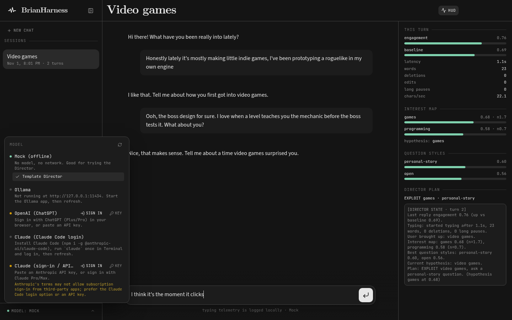

# BrianHarness

An adaptive "AI Director" chat bot that learns what draws you in from your typing (EEG later).
See [docs/ARCHITECTURE.md](docs/ARCHITECTURE.md).



## Quick start

```bash
npm install            # also downloads the Electron binary (postinstall)
npm test               # builds core+sim, runs unit + sim tests
npm run sim            # simulated personas vs the Director (offline mock model)
npm run desktop        # build and launch the desktop chat app
```

Shortcuts in the app: `Enter` send, `Shift+Enter` newline, `Ctrl/Cmd+H` Director HUD, `Ctrl/Cmd+B` sidebar.

## Models: pick one in the app (sidebar footer, "MODEL: …")

Click the **model** row at the bottom of the sidebar to open the picker. You can switch at any
time, even mid-chat (the Director keeps its state), and the choice is remembered in
`~/Library/Application Support/BrianHarness/settings.json`.

| Provider | How to connect on your Mac | Cost |
|---|---|---|
| **Mock** | always there | free, offline |
| **Ollama** | install the Ollama app, `ollama pull gemma3:4b`, then click ↻ in the picker. It's detected at `127.0.0.1:11434`; set `OLLAMA_HOST` to change that. | local models are free; `*:cloud` models are billed by Ollama |
| **OpenAI (ChatGPT)** | Click **Sign in**. Your browser opens ChatGPT's login; approve it, and the app gets the callback. You can also click **Key** and paste an `sk-…` API key. | sign-in uses your ChatGPT Plus/Pro plan limits; a key is billed per token |
| **Claude (Claude Code login)**, recommended for Claude | Run `npm i -g @anthropic-ai/claude-code`, then `claude` in Terminal, and log in with your Claude Pro/Max account. Then pick it in the picker. The app runs `claude -p` with tools, MCP, hooks and session saving all off. | your Claude plan's limits |
| **Claude (sign-in / API key)** | **Key** with an `sk-ant-…` Anthropic API key, or **Sign in** with Claude Pro/Max. Anthropic's terms may not allow subscription OAuth in third-party apps, so prefer the Claude Code option. | the key is billed per token |

Credentials are kept in `~/Library/Application Support/BrianHarness/credentials.json` (0600). The file is
encrypted with Electron `safeStorage`, so the key stays in your login Keychain. They are never stored in the repo,
and the renderer never sees them. Sign-in and model calls use [pi-ai](https://www.npmjs.com/package/@earendil-works/pi-ai)
(MIT), which is loaded only when you pick OpenAI/Claude.

Dev overrides: you can set `BH_PROVIDER=ollama|openai|anthropic|claude-code|mock` with `BH_MODEL=…`, or the legacy
`EEG_BACKEND=openai EEG_API_KEY=… EEG_BASE_URL=…`.

### Simulator and sidecar

```bash
npm run sim -- --provider ollama                    # auto-detects a local model; free
npm run sim -- --provider ollama --model gemma4:cloud --allow-paid   # cloud = paid, needs the flag
npm run sim -- --temperature 0.7 --backend-seed 3
```
Paid backends (cloud/API/subscription) are refused without `--allow-paid`.
The JSON-lines **sidecar** + Python adapter for other harnesses are covered in [docs/SIDECAR.md](docs/SIDECAR.md).

## Renaming

The product name lives in one file, `packages/core/src/brand.json`. The window title, wordmark,
electron-builder name/appId and sim banner all read it.

## Packaging for macOS (Apple Silicon)

On the Mac: `npm install && npm run dist:mac -w @brianharness/desktop` -> `apps/desktop/release/*.dmg` (unsigned).
For a signed/notarized build, set a Developer ID identity and notarize credentials in
`apps/desktop/electron-builder.cjs`. An app icon (`build/icon.icns`) is still TODO.
